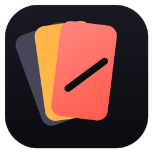

<div align="center">



# Cutdeck

**Long videos in. Shorts out.**

Paste a YouTube, Kick or Twitch link, or drop in a video. Cutdeck finds the moments worth
posting, frames them for vertical, adds animated captions and hands you ready-to-post 1080×1920
clips. It runs on your own computer.

A [mohanbuilds](https://mohanbuilds.com) app · Windows 10/11 (macOS build in progress)

</div>

---

## Download

Get the latest **`Cutdeck_x.y.z_x64-setup.exe`** from
[Releases](https://github.com/Mohanyadav-codes/CUTDCK/releases/latest) and run it.

> **"Windows protected your PC"?** Cutdeck isn't code-signed yet. Click **More info → Run anyway**.
> The installer needs no admin rights and installs only for your user.

On first launch Cutdeck asks for an AI key, then downloads the tools it needs (about 150 MB, once).

## Getting a free AI key (1 minute)

1. Go to [console.groq.com/keys](https://console.groq.com/keys) and sign in with Google.
2. Click **Create API key** and copy it.
3. Paste it into Cutdeck and click **Connect**.

Groq's free tier covers transcription and moment picking. Other options:

| Provider | Cost | Notes |
|---|---|---|
| **Groq** (recommended) | Free tier | Transcription and picking with one key |
| Gemini | Free tier | Picking; add a Groq key or on-device Whisper for captions |
| Grok (xAI), OpenAI, OpenRouter | Paid | Any OpenAI-compatible key works |
| Open-source model | Free | Run Ollama or LM Studio yourself; add on-device Whisper for fully offline use |

Keys are stored in Windows Credential Manager, never in plain files or logs.

## How to use it

- **The corner button.** After setup, a coral button sits in the corner of your screen.
  - **Click it** and paste a link (if you've copied one, Cutdeck offers it right away).
  - **Drag a video file** onto it.
- **Swipe the deck.** When clips are ready, they fan out as cards. Hover to play.
  **Flick right** to keep, **left** to skip.
- **Drag clips out.** Kept clips export in the background to `Videos\Cutdeck`. Drag them from the
  stack beside the button straight into YouTube Studio, TikTok, WhatsApp or Explorer.
- **Fine-tune in the Studio.** Click the tray icon or "Edit" to open the Studio. Change framing,
  caption style and hook text, or trim by clicking words in the transcript.

## What it does

| | |
|---|---|
| **Finds the moments** | Transcribes the video, then an AI editor picks clips that open on a hook and end on the payoff. Loudness peaks and (for past YouTube streams) chat replay spikes count too. |
| **Frames for vertical** | Follows the speaker's face, switches between speakers, puts a streamer's facecam above the gameplay, or fits the whole frame over a blurred copy. |
| **Cleans the edit** | Cuts dead air and filler words ("um", "uh"). Loud action without talking is kept. |
| **Captions** | Word-by-word animated captions in five styles (Beast, Hype, Bold, Neon, Clean) plus an optional hook banner. |
| **Long streams** | For streams over an hour, it listens only to the liveliest stretches, so a 4-hour VOD takes minutes. |
| **Fast** | Downloads only the audio and the few seconds of video it needs. Exports with your GPU's encoder when available. |

## Privacy

Video stays on your computer. For transcription, compressed audio goes to the AI provider you
chose (or nowhere, with on-device Whisper). The transcript goes to that provider for picking.
There's no Cutdeck server, account or telemetry.

Only clip content you have the rights to use.

## Building from source

Requirements: Rust (stable, MSVC on Windows), Node 20+, pnpm.

```sh
pnpm install
pnpm tauri dev                 # run the app
cargo test -p cutdeck-engine   # engine tests
pnpm tauri build --bundles nsis
```

The engine also runs from the command line:

```sh
cargo run -p cutdeck-cli -- deps                       # install FFmpeg, yt-dlp, Deno
CUTDECK_PROVIDER=groq CUTDECK_KEY=... \
  cargo run -p cutdeck-cli -- run "https://youtu.be/..." --clips 6 --out ./clips
```

### Layout

```
crates/engine   pipeline: links, audio, transcription, picking, faces, framing, edit list, captions, render
crates/cli      command-line runner for the engine
src-tauri       desktop app: windows, corner tray, queues, settings, keychain
src             React UI: onboarding, Studio, corner tray
docs            plan, spec, task list, third-party notices
```

## Licence

Source-available, all rights reserved. See [LICENSE](LICENSE) and
[third-party notices](docs/THIRD_PARTY.md).
